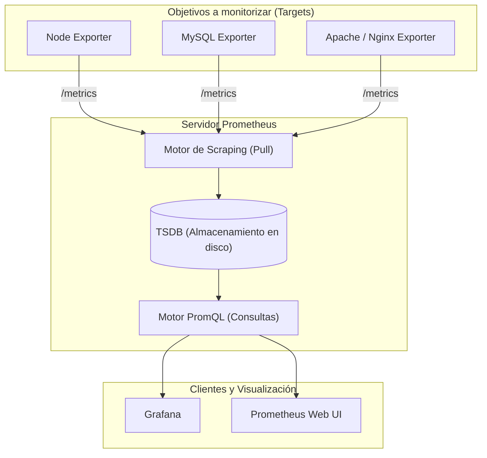
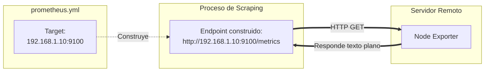

# 🚀 00. Introducción a Prometheus y Grafana

  <a href="README.md">🏠 Índice Principal</a> •
  <a href="1.Instalacion_Prometheus.md">Siguiente: Instalación de Prometheus ➡️</a>

---

## 📋 1. ¿Qué es la monitorización moderna?

En la administración de sistemas tradicional, la monitorización solía basarse en sondeos binarios (*"¿el servidor responde al ping?"*, *"¿el puerto 80 está abierto?"*). En entornos modernos de producción, microservicios y **DevOps**, esto resulta insuficiente: es necesario comprender el comportamiento interno del sistema en el tiempo (saturación de CPU, consumo de memoria, latencias de peticiones, colas de disco o consultas lentas de bases de datos).

La combinación de **Prometheus** (como motor de recolección y base de datos de métricas) y **Grafana** (como plataforma interactiva de visualización y alertas) constituye el estándar de la industria (*de facto*) para la observabilidad en Linux y contenedores.

---

## 2. ¿Qué es Prometheus?

**Prometheus** es un sistema de monitorización y alertas de código abierto (*open source*) diseñado originalmente por SoundCloud y mantenido actualmente por la **CNCF** (*Cloud Native Computing Foundation*).

### ⚙️ Características principales
- **Almacenamiento de series temporales (TSDB):** Los datos se almacenan como flujos de valores marcados en el tiempo (*timestamps*) identificados por un nombre de métrica y pares clave-valor de etiquetas (*labels*).
- **Modelo Pull (Scraping):** En lugar de que los agentes envíen datos de forma masiva al servidor central (*Push*), Prometheus realiza peticiones HTTP periódicas a los destinos (*Pull*) para consultar sus métricas.
- **Lenguaje de consultas PromQL (*Prometheus Query Language*):** Permite filtrar, agregar, calcular tasas de cambio (*rates*) y proyectar tendencias en tiempo real.
- **Alertas y notificaciones configurables:** Detección de anomalías y derivación a *Alertmanager*.
- **Extensibilidad mediante *Exporters*:** Capacidad para monitorizar cualquier componente (servidores, redes, bases de datos, proxies) sin necesidad de modificar el código de la aplicación.

---

## 3. ¿Qué son los Exporters?

Los **exporters** son programas ligeros o servicios que actúan como "traductores": leen las estadísticas internas de un sistema operativo, aplicación o base de datos y las exponen en un formato de texto plano comprensible por Prometheus a través de un endpoint HTTP (por defecto en la ruta `/metrics`).

### 📌 Exporters más utilizados

| Exporter | Función | Puerto Habitual |
| :--- | :--- | :---: |
| **Node Exporter** | Recolecta métricas de hardware y del kernel de Linux (CPU, RAM, discos, red). | `9100` |
| **MySQL / MariaDB Exporter** | Expone estadísticas del motor relacional (conexiones, consultas, buffers, bloqueos). | `9104` |
| **PostgreSQL Exporter** | Métricas de rendimiento, transacciones y bloqueos de PostgreSQL. | `9187` |
| **Blackbox Exporter** | Prueba la disponibilidad y latencia de servicios de red (HTTP, HTTPS, DNS, TCP, ICMP). | `9115` |
| **Nginx / Apache Exporter** | Extrae estadísticas de peticiones concurrentes, tráfico y códigos HTTP. | `9113` / `9117` |

### 🔍 Métricas extraídas por el Node Exporter:
- 🧠 **CPU:** Tiempos de procesamiento desglosados (`user`, `system`, `idle`, `iowait`, `steal`).
- 💾 **Memoria (`meminfo`):** Memoria RAM física total, libre, buffers, caché y memoria disponible real.
- 💽 **Discos (`diskstats`):** Lecturas/escrituras por segundo (IOPS), tiempos de espera (*await*) y rendimiento.
- 🌐 **Red (`netdev`):** Bytes recibidos/transmitidos, paquetes erróneos y caídos (*drop*).
- 📁 **Sistemas de archivos (`filesystem`):** Espacio total, ocupado e inodos en cada partición montada.
- ⚙️ **Carga del sistema (`loadavg`):** Promedio de carga a 1, 5 y 15 minutos.
- 🔒 **Entropía (`entropy`):** Disponibilidad de aleatoriedad del sistema para operaciones criptográficas.
- 🌡️ **Sensores (`hwmon`):** Temperaturas, voltajes y ventiladores.

---

## 4. ¿Qué es Grafana?

**Grafana** es la herramienta de visualización y análisis de datos de código abierto más popular del mundo. Permite transformar datos crudos procedentes de múltiples fuentes en cuadros de mando interactivos (*dashboards*) claros y estéticamente atractivos.

### 🌟 Puntos fuertes de Grafana:
- **Visualización avanzada:** Gráficos de series temporales, indicadores de estado (*Stat*), velocímetros (*Gauge*), mapas de calor (*Heatmap*), gráficos de barras y tablas interactivas.
- **Soporte multiorigen (*Data Sources*):** No solo se conecta a Prometheus; permite unificar datos de MySQL, PostgreSQL, InfluxDB, Elasticsearch, CloudWatch y decenas de fuentes en un único panel.
- **Dashboards públicos comunitarios:** Miles de plantillas prediseñadas listas para importar (por ejemplo, el ID `1860` para Node Exporter).
- **Sistema de alertas multicanal:** Notificaciones automáticas a través de correo electrónico (Gmail/SMTP), Telegram, Discord, Slack o webhooks cuando un valor sobrepasa un umbral crítico.

---

## 5. Conceptos clave antes de la instalación

Para comprender el funcionamiento de la infraestructura, es indispensable dominar los siguientes términos:

### 1. Métricas y Series Temporales
Una serie temporal en Prometheus está compuesta por:
- **Nombre de la métrica:** Define el recurso medido (ej. `node_cpu_seconds_total`).
- **Etiquetas (*Labels*):** Pares clave-valor que añaden dimensionalidad (ej. `{mode="idle", cpu="0", instance="172.26.12.21:9100"}`).
- **Timestamp:** Marca temporal en milisegundos.
- **Valor:** Un número flotante de 64 bits (*float64*).

### 2. Scraping, Exporter, Endpoint y Target

- **Scraping:** Acción periódica en la que Prometheus hace una petición HTTP GET al endpoint para descargar las métricas.
- **Endpoint:** La URL exacta donde se sirven las métricas (por ejemplo, `http://192.168.1.10:9100/metrics`).
- **Target:** La instancia definida en la directiva de configuración de Prometheus (ej. `"192.168.1.10:9100"`).

### ❓ ¿Qué ocurre si tenemos dos exporters en el mismo servidor?
Si en un servidor Debian (`192.168.1.10`) se instalan Node Exporter y MySQL Exporter:
- **Node Exporter:** Target `192.168.1.10:9100` $\rightarrow$ Endpoint `http://192.168.1.10:9100/metrics`
- **MySQL Exporter:** Target `192.168.1.10:9104` $\rightarrow$ Endpoint `http://192.168.1.10:9104/metrics`

> **Resultado:** Tenemos un solo servidor físico/virtual, pero **dos targets y dos endpoints independientes** configurados en Prometheus.

---

## 6. Escenarios de Despliegue

A lo largo de este proyecto trabajaremos sobre los dos escenarios habituales:

### 🖥️ Escenario 1: Monomáquina (Entorno de pruebas / Laboratorio)
- **Objetivo:** Instalar Prometheus, Node Exporter y Grafana en un único equipo local.
  - Prometheus: `http://localhost:9090`
  - Node Exporter: `http://localhost:9100/metrics`
  - Grafana: `http://localhost:3000`
- **Ideal para:** Demostraciones, desarrollo de paneles y pruebas iniciales.

### 🌐 Escenario 2: Entorno Distribuido (Producción)
- **Objetivo:** Un servidor central alojando Prometheus y Grafana, recolectando métricas a través de la red local desde múltiples servidores remotos (que ejecutan Node Exporter o MariaDB Exporter).
- **Ideal para:** Monitorización centralizada de infraestructuras empresariales.

---

  <a href="README.md">🏠 Índice Principal</a> •
  <a href="1.Instalacion_Prometheus.md">Siguiente: Instalación de Prometheus ➡️</a>

