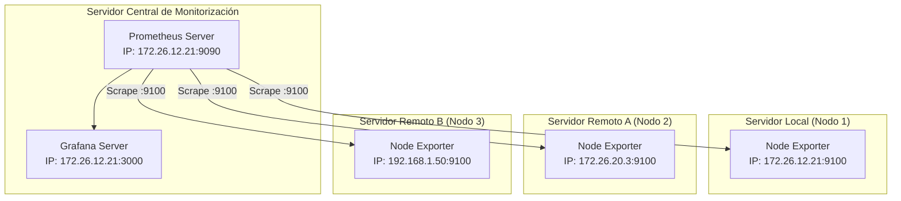

# 🌐 04. Monitorización de Varios Servidores con Node Exporter

<p align="center">
  <a href="3.Prometheus_Data_Source.md">⬅️ Anterior: Añadir Data Source</a> •
  <a href="README.md">Índice Principal 🏠</a> •
  <a href="5.Estresando_al_servidor.md">Siguiente: Estresando al servidor ➡️</a>
</p>

---

## 📋 Introducción

En una infraestructura real, el servidor de monitorización central (**Prometheus + Grafana**) supervisa decenas o cientos de máquinas virtuales o físicas distribuidas.

Para ello, se instala el agente **Node Exporter** en cada uno de los servidores cliente y se configuran los respectivos **targets** en el archivo `prometheus.yml` del servidor central.

---

## 🏗️ Topología del Laboratorio



---

## 1. Instalación de Node Exporter en los Servidores Cliente

En **cada uno de los servidores** que desees monitorizar, realiza el siguiente procedimiento:

### Método A: Instalación rápida mediante APT
```bash
sudo apt update
sudo apt install -y prometheus-node-exporter
```
El servicio arrancará automáticamente en el puerto `9100`.

---

### Método B: Instalación con Binario Oficial de GitHub
```bash
# Crear usuario sin login
sudo useradd -rs /bin/false node_exporter

# Descargar e instalar la versión estable
cd /tmp
wget https://github.com/prometheus/node_exporter/releases/download/v1.7.0/node_exporter-1.7.0.linux-amd64.tar.gz
tar -xvf node_exporter-1.7.0.linux-amd64.tar.gz
sudo cp node_exporter-1.7.0.linux-amd64/node_exporter /usr/local/bin/

# Crear servicio systemd
sudo nano /etc/systemd/system/node_exporter.service
```

Añadir el contenido del servicio:
```ini
[Unit]
Description=Prometheus Node Exporter
Wants=network-online.target
After=network-online.target

[Service]
User=node_exporter
Group=node_exporter
Type=simple
ExecStart=/usr/local/bin/node_exporter

[Install]
WantedBy=multi-user.target
```

Iniciar y habilitar el servicio:
```bash
sudo systemctl daemon-reload
sudo systemctl enable --now node_exporter
```

---

### Paso 2: Verificar apertura de puertos y endpoint de métricas
Verifica que el puerto `9100` está a la escucha en el nodo:
```bash
ss -plunt | grep 9100
```

Si el servidor tiene el cortafuegos `ufw` activado, permite el tráfico en el puerto `9100` exclusivamente desde la IP del servidor Prometheus:
```bash
sudo ufw allow from 172.26.12.21 to any port 9100 proto tcp
```

Comprueba desde el servidor central que las métricas son accesibles mediante `curl`:
```bash
curl http://<IP_DEL_NODO_CLIENTE>:9100/metrics | head -n 20
```

---

## 2. Configurar Prometheus para Recolectar Múltiples Servidores

En el **servidor central de Prometheus**, editamos el archivo `/etc/prometheus/prometheus.yml`:

```bash
sudo nano /etc/prometheus/prometheus.yml
```

Localizamos el bloque `scrape_configs` y definimos un job para los servidores Linux:

```yaml
scrape_configs:
  # Monitorización del propio servidor Prometheus
  - job_name: "prometheus"
    static_configs:
      - targets: ["localhost:9090"]

  # Monitorización de la granja de servidores Linux
  - job_name: "servidores_linux"
    scrape_interval: 10s
    static_configs:
      # Nodo 1: Servidor Local
      - targets: ["172.26.12.21:9100"]
        labels:
          servidor: "srv-monitoreo"
          entorno: "produccion"
          datacenter: "local"

      # Nodo 2: Servidor Remoto
      - targets: ["172.26.20.3:9100"]
        labels:
          servidor: "srv-profesor"
          entorno: "laboratorio"
          datacenter: "aula-213"

      # Nodo 3: Servidor Web Adicional
      - targets: ["192.168.1.50:9100"]
        labels:
          servidor: "srv-web"
          entorno: "desarrollo"
          datacenter: "cloud"
```

### Recargar la configuración de Prometheus:
Recargamos la configuración sin reiniciar el servicio:
```bash
curl -X POST http://localhost:9090/-/reload
```
*(O alternativamente: `sudo systemctl reload prometheus`)*

---

## 3. Comprobar el Estado de los Targets en Prometheus

1. Abre en tu navegador la web de Prometheus: `http://localhost:9090`.
2. Dirígete a **Status** $\rightarrow$ **Targets**.
3. Deberás ver el grupo **`servidores_linux`** con todas las instancias añadidas:
   - El estado debe mostrarse en color verde: **`UP`**.
   - Se mostrarán las etiquetas personalizadas (`servidor="srv-profesor"`, `entorno="laboratorio"`, etc.).

---

## 4. Visualización en Grafana con el Dashboard "Node Exporter Full"

En lugar de construir decenas de paneles manualmente para cada servidor, Grafana permite importar plantillas comunitarias completas:

### Paso 1: Importar el Dashboard ID 1860
1. Accede a Grafana (`http://localhost:3000`).
2. En el menú superior o lateral, haz clic en **Dashboards** $\rightarrow$ **New** $\rightarrow$ **Import**.
3. En el campo *Find via grafana.com*, introduce el identificador:
   ```text
   1860
   ```
4. Haz clic en **Load**.
5. En el menú desplegable inferior, selecciona tu Data Source (**Prometheus**).
6. Haz clic en **Import**.

---

### Paso 2: Filtrado dinámico entre servidores
El dashboard importado incluye automáticamente una barra superior con la variable **`Host` / `Instance`**:
- Al hacer clic sobre el desplegable de servidores, puedes seleccionar **Nodo 1**, **Nodo 2** o **Todos**, visualizando al instante:
  - Carga de CPU por núcleo.
  - Memoria RAM disponible y Swap.
  - Tráfico por interfaz de red.
  - Espacio y operaciones I/O en disco.

---

<p align="center">
  <a href="3.Prometheus_Data_Source.md">⬅️ Anterior: Añadir Data Source</a> •
  <a href="README.md">Índice Principal 🏠</a> •
  <a href="5.Estresando_al_servidor.md">Siguiente: Estresando al servidor ➡️</a>
</p>
