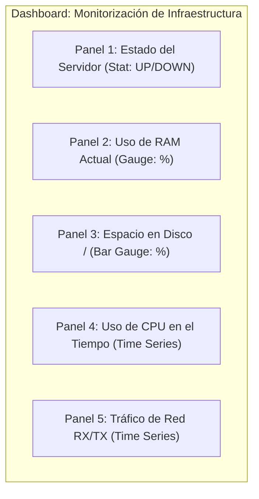

# 📊 06. Creación de Consultas PromQL y Diseño de Nuevos Paneles

<p align="center">
  <a href="5.Estresando_al_servidor.md">⬅️ Anterior: Estresando al servidor</a> •
  <a href="README.md">Índice Principal 🏠</a> •
  <a href="7.Alertas_con_Gmail.md">Siguiente: Alertas con Gmail ➡️</a>
</p>

---

## 📋 Introducción

Dominar **PromQL** (*Prometheus Query Language*) es la habilidad esencial de cualquier administrador de sistemas que gestione Prometheus. Permite extraer valor de millones de puntos de datos en bruto mediante agregaciones, filtros dimensionales y cálculos de tasas de cambio en tiempo real.

En esta unidad desglosaremos la sintaxis de PromQL y construiremos un **dashboard personalizado desde cero** en Grafana con visualizaciones de tipo *Time series*, *Gauge*, *Stat* y variables dinámicas.

---

## 1. Fundamentos de PromQL

### 🔹 Tipos de Vectores
1. **Instant Vector (Vector instantáneo):** Muestra el valor más reciente de cada serie temporal en un momento concreto.
   ```promql
   node_memory_MemAvailable_bytes
   ```
2. **Range Vector (Vector de rango):** Muestra un conjunto de valores históricos a lo largo de una ventana de tiempo (se indica entre corchetes `[ventana]`).
   ```promql
   node_cpu_seconds_total[5m]
   ```

---

### 🔹 Funciones Esenciales

| Función | Utilidad | Ejemplo |
| :--- | :--- | :--- |
| **`rate()`** | Calcula la tasa de incremento medio por segundo de un contador a lo largo de una ventana de tiempo. Ideal para métricas acumulativas continuas. | `rate(node_network_receive_bytes_total[1m])` |
| **`irate()`** | Calcula la tasa instantánea considerando exclusivamente los **dos últimos puntos** de la serie temporal. Más reactivo para picos breves. | `irate(node_cpu_seconds_total[1m])` |
| **`sum()`** | Suma los valores de las series coincidentes. | `sum(node_cpu_seconds_total)` |
| **`avg()`** | Calcula el promedio de las series temporales. | `avg(rate(node_cpu_seconds_total[1m]))` |
| **`by (...)`** | Cláusula de agrupación: preserva únicamente las etiquetas indicadas en el resultado agregado. | `avg by (instance) (...)` |
| **`without (...)`**| Cláusula de exclusión: elimina las etiquetas indicadas del resultado. | `sum without (cpu) (...)` |

---

## 2. Consultas PromQL Clave para Administración de Servidores

### 1. Porcentaje Real de Uso de CPU Global
Los sistemas Linux reportan el tiempo de CPU acumulado en segundos por cada modo (`idle`, `user`, `system`, `iowait`, etc.). Para calcular el uso real, restamos el porcentaje de tiempo inactivo (*idle*) al $100\%$:

```promql
100 - (avg by (instance) (rate(node_cpu_seconds_total{mode="idle"}[1m])) * 100)
```

---

### 2. Porcentaje de Memoria RAM Ocupada
La memoria RAM ocupada real se obtiene restando la memoria disponible a la memoria total:

```promql
100 * (1 - (node_memory_MemAvailable_bytes / node_memory_MemTotal_bytes))
```

---

### 3. Porcentaje de Espacio Libre en el Disco Raíz (`/`)

```promql
100 * (node_filesystem_free_bytes{mountpoint="/"} / node_filesystem_size_bytes{mountpoint="/"})
```

---

### 4. Tráfico de Red Entrante y Saliente (en KB/s)

```promql
# Tráfico Recibido (Download)
rate(node_network_receive_bytes_total{device="eno1"}[1m]) / 1024

# Tráfico Transmitido (Upload)
rate(node_network_transmit_bytes_total{device="eno1"}[1m]) / 1024
```

---

### 5. Estado de Disponibilidad de Servidores (`UP / DOWN`)

```promql
up{job="servidores_linux"}
```
*(Devuelve `1` si el target responde al scrape o `0` si el host o el exporter están caídos).*

---

## 3. Diseño de un Dashboard Personalizado en Grafana

Vamos a diseñar un cuadro de mando profesional que reúna estas métricas en un único panel unificado:



### Paso 1: Crear el Dashboard
1. En Grafana, haz clic en **Dashboards** $\rightarrow$ **New** $\rightarrow$ **New Dashboard**.
2. Haz clic en **+ Add visualization**.
3. Selecciona el origen de datos **Prometheus**.

---

### Paso 2: Crear el Panel de Estado (*Stat*)
- **Query (A):**
  ```promql
  up{instance=~"$instance"}
  ```
- **Panel options:**
  - *Title:* `Estado del Servidor`
  - *Type:* **Stat**
- **Value mappings (Mapeo de valores):**
  - Valor `1` $\rightarrow$ Texto: `ONLINE`, Color: Verde.
  - Valor `0` $\rightarrow$ Texto: `OFFLINE`, Color: Rojo.

---

### Paso 3: Crear el Panel de Uso de RAM (*Gauge*)
- **Query (A):**
  ```promql
  100 * (1 - (node_memory_MemAvailable_bytes{instance=~"$instance"} / node_memory_MemTotal_bytes{instance=~"$instance"}))
  ```
- **Panel options:**
  - *Title:* `Consumo de Memoria RAM`
  - *Type:* **Gauge**
- **Standard options:**
  - *Unit:* `Misc` $\rightarrow$ `Percent (0-100)`
  - *Min:* `0`, *Max:* `100`
- **Thresholds (Umbrales de color):**
  - Verde: Base ($0\%$).
  - Amarillo: $> 75\%$.
  - Rojo: $> 90\%$.

---

### Paso 4: Crear el Panel de Histórico de CPU (*Time Series*)
- **Query (A):**
  ```promql
  100 - (avg by (instance) (rate(node_cpu_seconds_total{mode="idle", instance=~"$instance"}[1m])) * 100)
  ```
- **Panel options:**
  - *Title:* `Evolución de Carga de CPU`
  - *Type:* **Time series**
- **Standard options:**
  - *Unit:* `Misc` $\rightarrow$ `Percent (0-100)`
  - *Min:* `0`, *Max:* `100`

---

### Paso 5: Crear el Panel de Tráfico de Red (*Time Series*)
- **Query (A) - Recepción (RX):**
  ```promql
  rate(node_network_receive_bytes_total{instance=~"$instance", device!~"lo|docker.*|veth.*"}[1m])
  ```
  *(Legend: `RX {{device}}`)*
- **Query (B) - Transmisión (TX):**
  ```promql
  rate(node_network_transmit_bytes_total{instance=~"$instance", device!~"lo|docker.*|veth.*"}[1m])
  ```
  *(Legend: `TX {{device}}`)*
- **Standard options:**
  - *Unit:* `Data rate` $\rightarrow$ `Bytes/sec (SI)`

---

## 4. Creación de Variables Dinámicas (Plantillas de Servidores)

Para que el dashboard permita seleccionar cualquier servidor monitorizado con un desplegable:

1. Dentro de tu Dashboard, haz clic en el icono de engranaje **Dashboard settings** (arriba a la derecha).
2. Haz clic en **Variables** $\rightarrow$ **Add variable**.
3. Configura los siguientes parámetros:
   - **Name:** `instance`
   - **Label:** `Servidor`
   - **Type:** `Query`
   - **Data source:** `Prometheus`
   - **Query:**
     ```promql
     label_values(up{job="servidores_linux"}, instance)
     ```
   - **Selection options:**
     - Activa: `Multi-value` (Permite seleccionar varios servidores a la vez).
     - Activa: `Include All option` (Permite ver todos a la vez).
4. Haz clic en **Apply** y guarda el Dashboard.

> [!TIP]
> A partir de este momento, cualquier consulta que utilice `{instance=~"$instance"}` responderá de forma automática al servidor seleccionado en la barra superior.

---

<p align="center">
  <a href="5.Estresando_al_servidor.md">⬅️ Anterior: Estresando al servidor</a> •
  <a href="README.md">Índice Principal 🏠</a> •
  <a href="7.Alertas_con_Gmail.md">Siguiente: Alertas con Gmail ➡️</a>
</p>
