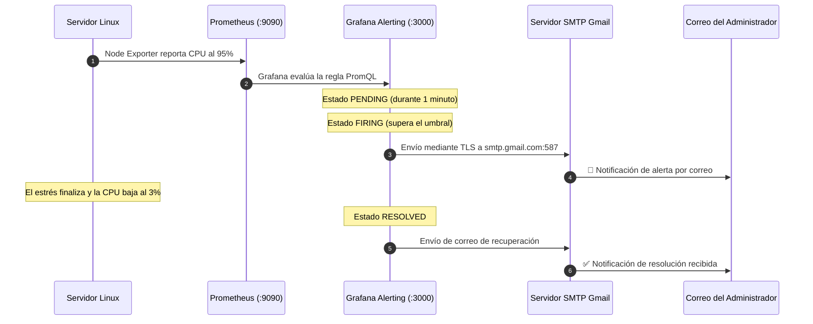

# 🔔 07. Configuración de Alertas con Gmail

<p align="center">
  <a href="6.Consultas_y_Paneles.md">⬅️ Anterior: Consultas y Paneles</a> •
  <a href="README.md">Índice Principal 🏠</a> •
  <a href="8.Tarea_Monitorizacion_MariaDB.md">Siguiente: Tarea MariaDB ➡️</a>
</p>

---

## 📋 Introducción

La monitorización reactiva no es suficiente: los administradores no pueden vigilar las pantallas de Grafana de forma ininterrumpida. El sistema debe ser **proactivo** y enviar notificaciones inmediatas por correo electrónico cuando se detecte una incidencia crítica (caída de un servicio, saturación de CPU o falta de espacio en disco).

En esta unidad configuraremos el motor **Grafana Alerting** junto al servidor SMTP de **Google (Gmail)** mediante una contraseña de aplicación segura.

---

## 🏗️ Flujo de Alertas



---

## 1. Generar una Contraseña de Aplicación en Google

Por motivos de seguridad, Google no permite utilizar la contraseña habitual de tu cuenta de correo en aplicaciones de terceros:

1. Inicia sesión en tu cuenta de Google y accede a [Mi Cuenta Google - Seguridad](https://myaccount.google.com/security).
2. Asegúrate de tener activada la **Verificación en 2 pasos**.
3. En la barra de búsqueda de la cuenta de Google, escribe **"Contraseñas de aplicaciones"** (*App Passwords*).
4. Asigna un nombre a la aplicación (por ejemplo, `Grafana-Alertas`).
5. Haz clic en **Crear**.
6. Google generará un código único de **16 caracteres** (ej. `abcd efgh ijkl mnop`).
7. **Copia y guarda esta contraseña**, ya que no volverá a mostrarse.

---

## 2. Configurar el Servidor SMTP en Grafana (`grafana.ini`)

Editamos el archivo de configuración del servidor Grafana:

```bash
sudo nano /etc/grafana/grafana.ini
```

Buscamos la sección `[smtp]` (alrededor de la línea 650) y ajustamos los parámetros eliminando los puntos y coma `;` al inicio de cada línea:

```ini
[smtp]
enabled = true
host = smtp.gmail.com:587
user = tu_correo@gmail.com
# Introduce la contraseña de aplicación de 16 caracteres generada en Google
password = abcd efgh ijkl mnop
cert_file =
key_file =
skip_verify = false
from_address = tu_correo@gmail.com
from_name = Grafana Monitor ASIR
ehlo_identity =
startTLS_policy = OpportunisticStartTLS
```

Guardamos los cambios (`Ctrl+O`, `Enter`, `Ctrl+X`) y reiniciamos el servicio:

```bash
sudo systemctl restart grafana-server
```

---

## 3. Crear el Punto de Contacto (*Contact Point*) en Grafana

1. Inicia sesión en Grafana (`http://localhost:3000`).
2. En el menú lateral, dirígete a **Alerting** $\rightarrow$ **Contact points**.
3. Haz clic en **+ Add contact point**.
4. Rellena los datos:
   - **Name:** `Admin-Gmail`
   - **Integration:** `Email`
   - **Addresses:** El correo electrónico donde deseas recibir las alertas (ej. `tu_correo@gmail.com`).
5. Antes de guardar, haz clic en el botón **Test contact point**.
6. Haz clic en **Send test notification**.
7. **Revisa tu bandeja de entrada de Gmail:** Deberás haber recibido un correo con el asunto *`[Test] Test notification`* procedente de *Grafana Monitor ASIR*.
8. Haz clic en **Save contact point**.

---

## 4. Definir la Regla de Alerta (*Alert Rule*)

Vamos a programar una alerta que se active si el uso de CPU de cualquier servidor supera el **$85\%$** de forma continua durante más de **1 minuto**:

1. En Grafana, ve a **Alerting** $\rightarrow$ **Alert rules** $\rightarrow$ **+ New alert rule**.
2. **Paso 1: Nombre de la regla**
   - *Rule name:* `Alerta_CPU_Sobrecarga`
3. **Paso 2: Definir la consulta y condición**
   - *Data source:* `Prometheus`
   - *Query (A):*
     ```promql
     100 - (avg by (instance) (rate(node_cpu_seconds_total{mode="idle"}[1m])) * 100)
     ```
   - *Expression (B) - Reduce:* Función `Last`, Input `A`.
   - *Expression (C) - Threshold:* Input `B`, Condición: `IS ABOVE 85`.
4. **Paso 3: Criterios de evaluación**
   - *Evaluate every:* `30s` (evalúa la condición cada 30 segundos).
   - *For:* `1m` (la condición debe mantenerse activa durante 1 minuto completo para pasar de `Pending` a `Firing`).
5. **Paso 4: Etiquetas y detalles de la notificación**
   - Añade la etiqueta: `severity = critical`
   - *Summary:* `Consumo de CPU crítico en el servidor {{ $labels.instance }}`
   - *Description:* `La CPU ha superado el 85% de uso continuo durante más de 1 minuto.`
6. Haz clic en **Save rule and exit** (arriba a la derecha).

---

## 5. Configurar la Política de Notificaciones (*Notification Policy*)

Para garantizar que las alertas críticas se envíen al contacto de Gmail:

1. Ve a **Alerting** $\rightarrow$ **Notification policies**.
2. En la política raíz (*Root policy*), edita el contacto predeterminado y selecciona **`Admin-Gmail`**.
3. Guarda la política (*Save policy*).

---

## 6. Simulación Práctica: Disparo y Resolución de la Alerta

Vamos a estresar intencionadamente el servidor para verificar todo el ciclo de vida de la alerta:

### 1. Provocar la sobrecarga de CPU:
En el servidor monitorizado, ejecutamos una carga al $100\%$ durante 2 minutos:

```bash
stress --cpu 4 --timeout 120s
```

### 2. Ciclo de estados en Grafana Alerting:
- **0 a 30s:** La CPU sube al $100\%$. La regla pasa al estado amarillo **`Pending`** (condición cumplida, esperando tiempo de persistencia).
- **A partir de 60s:** Se supera el tiempo configurado (`For 1m`). La regla pasa al estado rojo **`Firing`**.
- **Notificación:** Grafana envía de inmediato el correo a Gmail con el detalle del servidor y la gráfica asociada.

### 3. Recuperación automática (*Resolved*):
- Al concluir los 120 segundos de `stress`, la CPU vuelve al reposo ($2\%$).
- Grafana detecta que el valor ha caído por debajo de 85 y la regla pasa a estado **`Normal`**.
- Se envía automáticamente un correo de resolución con el encabezado **`[RESOLVED]`** confirmando que la incidencia ha sido solventada.

---

<p align="center">
  <a href="6.Consultas_y_Paneles.md">⬅️ Anterior: Consultas y Paneles</a> •
  <a href="README.md">Índice Principal 🏠</a> •
  <a href="8.Tarea_Monitorizacion_MariaDB.md">Siguiente: Tarea MariaDB ➡️</a>
</p>
