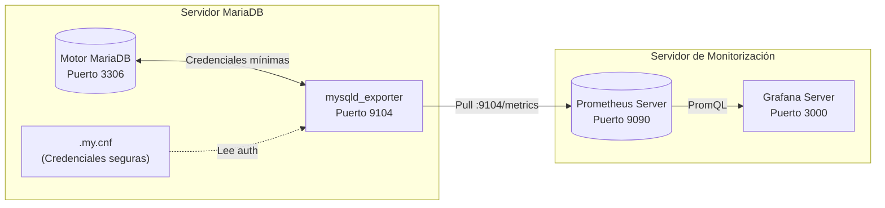

# 🗄️ 08. Tarea Práctica: Monitorización de Bases de Datos MariaDB

<p align="center">
  <a href="7.Alertas_con_Gmail.md">⬅️ Anterior: Alertas con Gmail</a> •
  <a href="README.md">Índice Principal 🏠</a>
</p>

---

## 🎯 Objetivo de la Tarea

En los entornos corporativos, las bases de datos relacionales constituyen el núcleo crítico de cualquier servicio. Una saturación en el número de conexiones o un aumento descontrolado de consultas lentas (*slow queries*) puede degradar por completo las aplicaciones dependientes.

En esta tarea práctica desplegaremos una solución integral de monitorización para **MariaDB** utilizando **Prometheus**, el agente especializado **`mysqld_exporter`** y **Grafana**.

---

## 🏗️ Arquitectura de la Solución



---

## Paso 1: Instalación y Preparación de MariaDB Server

Si el servidor no cuenta con MariaDB instalado, lo instalamos e iniciamos:

```bash
sudo apt update
sudo apt install -y mariadb-server

# Habilitar e iniciar el servicio
sudo systemctl enable --now mariadb

# Comprobar que está activo y escuchando en el puerto 3306
sudo systemctl status mariadb
ss -plunt | grep 3306
```

---

## Paso 2: Creación del Usuario de Monitorización en MariaDB

> [!IMPORTANT]
> **Principio de Mínimo Privilegio:** Nunca debe utilizarse el usuario administrador `root` para alimentar un exporter de métricas. Se debe crear un usuario de sistema dedicado con permisos estrictamente de solo lectura y limitar su número máximo de conexiones concurrentes para no penalizar a la base de datos.

Accedemos a la consola de MariaDB como superusuario:

```bash
sudo mysql -u root
```

Ejecutamos las siguientes sentencias SQL:

```sql
-- 1. Crear el usuario mysqld_exporter limitando sus conexiones concurrentes a 3
CREATE USER 'mysqld_exporter'@'localhost' IDENTIFIED BY 'PasswordSeguro123!' WITH MAX_USER_CONNECTIONS 3;

-- 2. Conceder los permisos de lectura de estados y variables globales del motor
GRANT PROCESS, REPLICATION CLIENT, SELECT ON *.* TO 'mysqld_exporter'@'localhost';

-- 3. Aplicar los privilegios
FLUSH PRIVILEGES;

-- 4. Salir de la consola
EXIT;
```

---

## Paso 3: Instalación y Configuración de `mysqld_exporter`

### 1. Creación de usuario de sistema y descarga del binario
```bash
# Crear usuario de sistema dedicado
sudo useradd -rs /bin/false mysqld_exporter

# Descargar e instalar el binario oficial
cd /tmp
wget https://github.com/prometheus/mysqld_exporter/releases/download/v0.15.1/mysqld_exporter-0.15.1.linux-amd64.tar.gz
tar -xvf mysqld_exporter-0.15.1.linux-amd64.tar.gz
sudo cp mysqld_exporter-0.15.1.linux-amd64/mysqld_exporter /usr/local/bin/
```

---

### 2. Archivo de credenciales protegido (`.my.cnf`)
Creamos un directorio seguro y almacenamos las credenciales de conexión:

```bash
sudo mkdir -p /etc/mysqld_exporter
sudo nano /etc/mysqld_exporter/.my.cnf
```

Introducimos la configuración de acceso local:

```ini
[client]
user=mysqld_exporter
password=PasswordSeguro123!
host=localhost
port=3306
```

Aseguramos los permisos para que **únicamente** el usuario `mysqld_exporter` pueda leer el archivo:

```bash
sudo chown -R mysqld_exporter:mysqld_exporter /etc/mysqld_exporter
sudo chmod 600 /etc/mysqld_exporter/.my.cnf
```

---

### 3. Creación del servicio Systemd
Creamos la unidad de servicio para gestionar el exporter en segundo plano:

```bash
sudo nano /etc/systemd/system/mysqld_exporter.service
```

Insertamos la siguiente definición:

```ini
[Unit]
Description=Prometheus MySQL / MariaDB Exporter
Wants=network-online.target
After=network-online.target

[Service]
User=mysqld_exporter
Group=mysqld_exporter
Type=simple
ExecStart=/usr/local/bin/mysqld_exporter \
    --config.my-cnf=/etc/mysqld_exporter/.my.cnf \
    --web.listen-address=0.0.0.0:9104

Restart=always

[Install]
WantedBy=multi-user.target
```

Iniciamos y habilitamos el servicio:

```bash
sudo systemctl daemon-reload
sudo systemctl enable --now mysqld_exporter

# Verificar estado y puerto 9104
sudo systemctl status mysqld_exporter
ss -plunt | grep 9104
```

---

### 4. Verificar la recolección de métricas
Comprobamos que el exporter está extrayendo datos reales de MariaDB:

```bash
curl http://localhost:9104/metrics | grep mysql_global_status_threads_connected
```
*(Deberá responder con un valor numérico indicando las conexiones abiertas actualmente).*

---

## Paso 4: Integración en Prometheus (`prometheus.yml`)

En el servidor Prometheus, editamos el archivo `/etc/prometheus/prometheus.yml`:

```bash
sudo nano /etc/prometheus/prometheus.yml
```

Añadimos el nuevo job de recolección al final del bloque `scrape_configs`:

```yaml
  # Monitorización de la base de datos MariaDB
  - job_name: "mariadb_database"
    scrape_interval: 10s
    static_configs:
      - targets: ["localhost:9104"]
        labels:
          servicio: "mariadb"
          rol: "database-server"
          entorno: "produccion"
```

Recargamos la configuración de Prometheus:

```bash
curl -X POST http://localhost:9090/-/reload
```

Comprobamos en `http://localhost:9090/targets` que el target **`mariadb_database`** aparece en estado verde **`UP`**.

---

## Paso 5: Visualización en Grafana con Dashboard de MariaDB

Para visualizar las métricas relacionales de MariaDB importamos un dashboard comunitario especializado:

1. Inicia sesión en Grafana (`http://localhost:3000`).
2. Ve a **Dashboards** $\rightarrow$ **New** $\rightarrow$ **Import**.
3. En el campo de ID introduce:
   ```text
   7362
   ```
   *(Alternativa oficial: ID `6844` - MySQL Overview).*
4. Selecciona tu Data Source **Prometheus** y haz clic en **Import**.

---

### 📊 Métricas Clave Monitorizadas en el Panel:

| Métrica | PromQL | Significado |
| :--- | :--- | :--- |
| **Conexiones Activas** | `mysql_global_status_threads_connected` | Conexiones de clientes abiertas actualmente. |
| **Consultas por Segundo (QPS)** | `rate(mysql_global_status_queries[1m])` | Caudal de transacciones que atiende el servidor. |
| **Consultas Lentas (Slow Queries)** | `rate(mysql_global_status_slow_queries[5m])` | Consultas que sobrepasan el tiempo de `long_query_time`. |
| **InnoDB Buffer Pool Hit Ratio** | `rate(mysql_global_status_innodb_buffer_pool_reads[1m])` | Eficiencia de lectura de páginas en memoria RAM vs disco. |
| **Tráfico de Red SQL** | `rate(mysql_global_status_bytes_sent[1m])` | Ancho de banda saliente generado por consultas de datos. |

---

## Paso 6: Prueba de Carga y Estrés con `mysqlslap`

Para validar que los paneles y alertas responden de forma realista, utilizaremos la herramienta oficial de benchmarking **`mysqlslap`** incluida con MariaDB:

```bash
# Simula 30 conexiones simultáneas realizando 10 iteraciones de consultas de prueba
mysqlslap --user=root -p --concurrency=30 --iterations=10 --number-int-cols=5 --number-char-cols=20 --auto-generate-sql
```

### 📈 Observación en tiempo real en Grafana:
- El velocímetro de **Threads Connected** salta de $2$ a $30$ conexiones.
- La gráfica de **Questions / Queries per Second** experimenta un pico inmediato de miles de consultas concurrentes.
- El uso de memoria del **InnoDB Buffer Pool** se incrementa al cachear las tablas generadas sintéticamente.

---

## 🏁 Conclusión de la Tarea

Con la finalización de esta práctica, disponemos de una infraestructura integral de observabilidad:
1. **Prometheus** centralizando métricas de sistema operativo y motores de bases de datos.
2. **Node Exporter** y **mysqld_exporter** capturando métricas de bajo nivel y de servicio.
3. **Grafana** ofreciendo cuadros de mando intuitivos con métricas de salud y rendimiento.
4. **Sistema de Alertas** activo que notificará automáticamente a nuestro correo de Gmail ante cualquier anomalía.

---

<p align="center">
  <a href="7.Alertas_con_Gmail.md">⬅️ Anterior: Alertas con Gmail</a> •
  <a href="README.md">Índice Principal 🏠</a>
</p>
