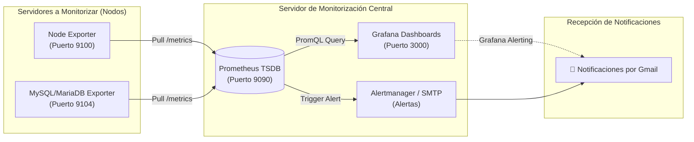

# 📊 Monitorización con Prometheus y Grafana

<p align="center">
  
  
  
  
  
  
</p>

---

## 📌 Descripción del Proyecto

Guía completa y profesional para el despliegue, configuración y administración de una infraestructura moderna de **monitorización de sistemas, servicios y bases de datos** mediante la pila **Prometheus + Grafana**, diseñada para el ciclo formativo de **Administración de Sistemas Informáticos en Red (2º ASIR)**.

A lo largo de este repositorio se aborda desde la teoría base de las bases de datos de series temporales (TSDB) y los *exporters*, hasta la monitorización de múltiples servidores Linux distribuidos, pruebas de estrés de hardware, diseño de dashboards personalizados en PromQL, alertas automáticas por correo electrónico (Gmail) y la monitorización de servidores de bases de datos MariaDB.

---

## 🏗️ Arquitectura General del Sistema



---

## 📑 Índice de Contenidos

| Unidad | Título del Módulo | Descripción y Objetivos | Acceso directo |
| :---: | :--- | :--- | :---: |
| **00** | [**Introducción a Prometheus y Grafana**](0.Introduccion.md) | Conceptos clave, TSDB, modelo Pull vs Push, anatomía de un Exporter y tipos de métricas. | [📖 Ver Unidad 0](0.Introduccion.md) |
| **01** | [**Instalación de Prometheus**](1.Instalacion_Prometheus.md) | Despliegue con binarios oficiales, usuario de sistema, servicio systemd y verificación web (`:9090`). | [📖 Ver Unidad 1](1.Instalacion_Prometheus.md) |
| **02** | [**Instalación de Grafana**](2.Instalacion_Grafana.md) | Configuración de repositorios oficiales APT de Grafana OSS, demonio `grafana-server` y primer acceso (`:3000`). | [📖 Ver Unidad 2](2.Instalacion_Grafana.md) |
| **03** | [**Añadir Prometheus como Data Source**](3.Prometheus_Data_Source.md) | Conexión e integración de Prometheus en Grafana, validación de la API y primer dashboard. | [📖 Ver Unidad 3](3.Prometheus_Data_Source.md) |
| **04** | [**Monitorización de varios servidores**](4.Monitorizacion_Varios_Servidores.md) | Despliegue de Node Exporter en nodos remotos, configuración de `targets` en `prometheus.yml` y dashboard 1860. | [📖 Ver Unidad 4](4.Monitorizacion_Varios_Servidores.md) |
| **05** | [**Estresando al servidor**](5.Estresando_al_servidor.md) | Simulación de carga artificial de CPU, RAM e I/O de disco con `stress` y `stress-ng` y análisis de impacto en vivo. | [📖 Ver Unidad 5](5.Estresando_al_servidor.md) |
| **06** | [**Consultas PromQL y Diseño de Paneles**](6.Consultas_y_Paneles.md) | Creación de consultas avanzadas con `rate()`, agregaciones, variables de plantilla y diseño de dashboards desde cero. | [📖 Ver Unidad 6](6.Consultas_y_Paneles.md) |
| **07** | [**Alertas con Gmail**](7.Alertas_con_Gmail.md) | Configuración de contraseñas de aplicación de Google, servidor SMTP en Grafana y reglas de alerta para incidentes. | [📖 Ver Unidad 7](7.Alertas_con_Gmail.md) |
| **08** | [**Tarea: Monitorización de MariaDB**](8.Tarea_Monitorizacion_MariaDB.md) | Instalación de `mysqld_exporter`, usuario con permisos de métricas en MariaDB, integración y panel de control. | [📖 Ver Unidad 8](8.Tarea_Monitorizacion_MariaDB.md) |

---

## 🔌 Resumen de Puertos y Servicios Clave

| Servicio / Componente | Puerto por defecto | Endpoint de Métricas | Propósito |
| :--- | :---: | :---: | :--- |
| **Prometheus Server** | `9090` | `/metrics` | Motor de recolección de métricas y consultas PromQL. |
| **Grafana** | `3000` | N/A | Interfaz visual interactiva y generación de alertas. |
| **Node Exporter** | `9100` | `/metrics` | Agente del sistema operativo (CPU, RAM, discos, red). |
| **MySQL / MariaDB Exporter** | `9104` | `/metrics` | Agente de rendimiento para el motor de base de datos. |
| **Alertmanager** | `9093` | `/metrics` | Gestor y enrutador de alertas de Prometheus (opcional). |

---

## 📂 Estructura del Repositorio

```text
.
├── 0.Introduccion.md                        # Teoría base, TSDB y conceptos previos
├── 1.Instalacion_Prometheus.md              # Instalación y servicio de Prometheus
├── 2.Instalacion_Grafana.md                 # Instalación y servicio de Grafana
├── 3.Prometheus_Data_Source.md              # Configuración de origen de datos en Grafana
├── 4.Monitorizacion_Varios_Servidores.md    # Node Exporter y entornos multiservidor
├── 5.Estresando_al_servidor.md              # Pruebas de carga con stress y análisis
├── 6.Consultas_y_Paneles.md                 # PromQL y creación de dashboards
├── 7.Alertas_con_Gmail.md                   # Sistema de alertas y notificaciones SMTP
├── 8.Tarea_Monitorizacion_MariaDB.md        # Práctica de monitorización de MariaDB
├── img/                                     # Capturas de pantalla y diagramas
├── LICENSE                                  # Licencia GNU General Public License v3.0
└── README.md                                # Portada y documentación general
```

---

## 👤 Autor

- **Daniel Silva** ([@JohnDSil](https://github.com/JohnDSil))
- 2º ASIR - Administración de Sistemas Informáticos en Red

---

## 📄 Licencia

Este proyecto está distribuido bajo la licencia [GNU General Public License v3.0](LICENSE).
